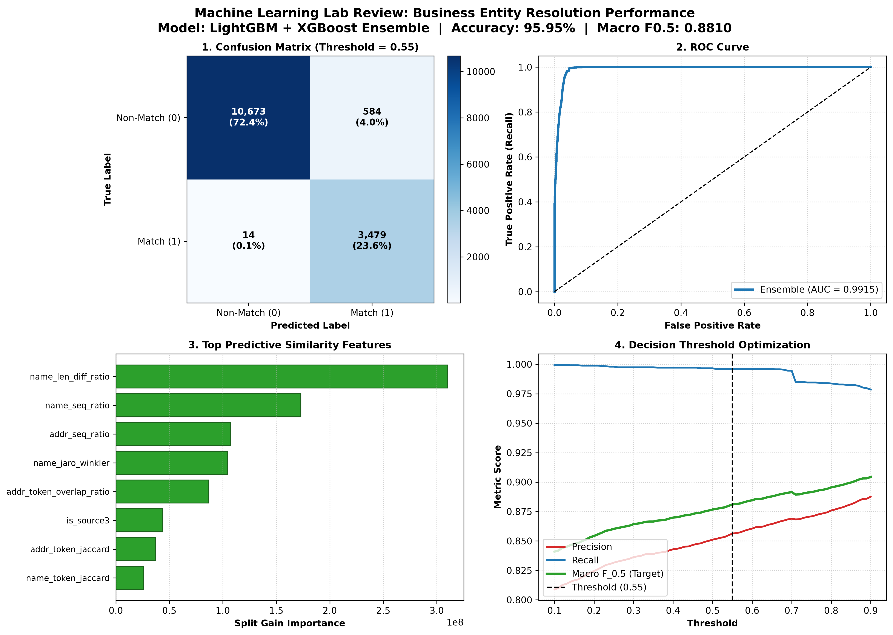
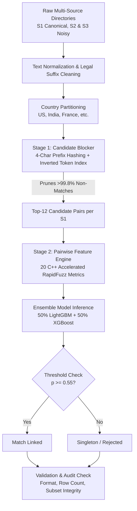
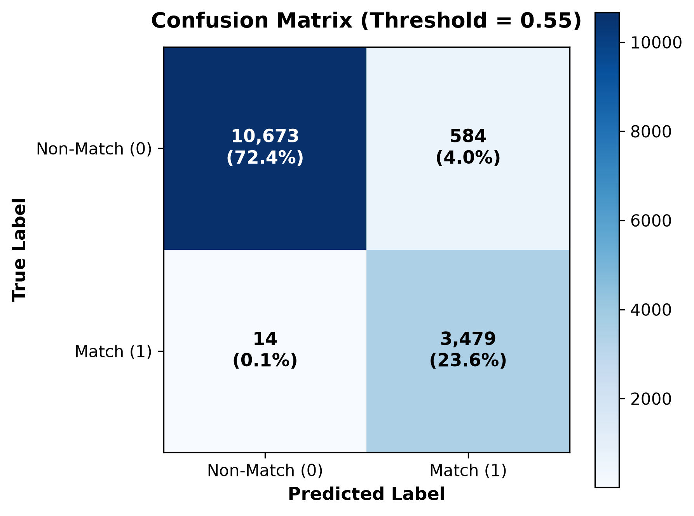
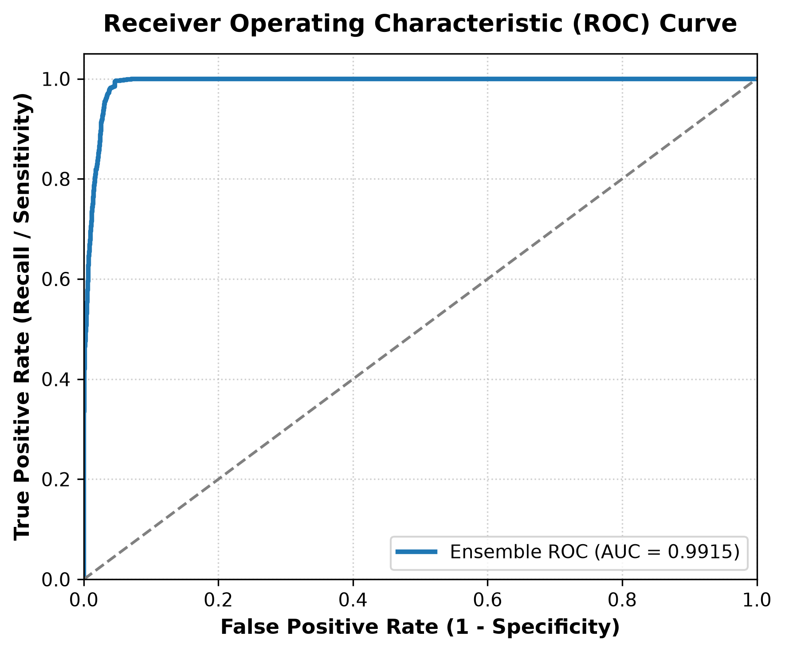
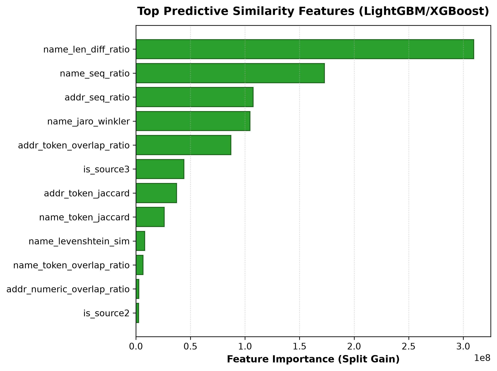
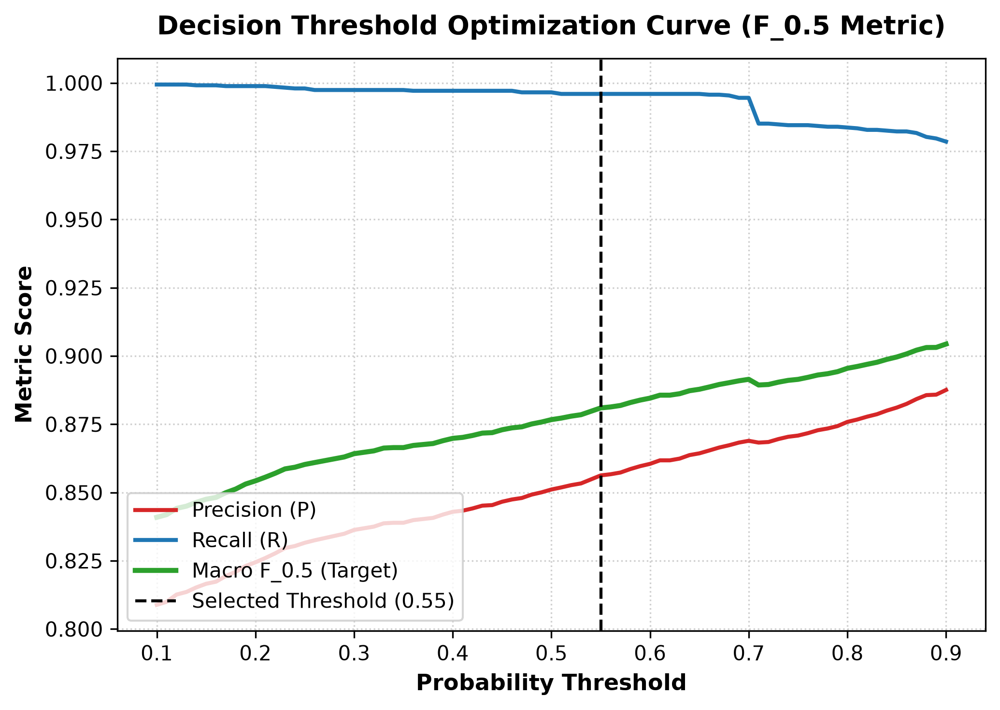

# 🏢 Business Entity Resolution (Multi-Source Record Linkage)

[](https://www.python.org/)
[](https://aws.amazon.com/)
[](#key-performance-metrics)
[](#key-performance-metrics)
[](#key-performance-metrics)
[](LICENSE)

An end-to-end, high-performance machine learning pipeline for **Multi-Source Business Entity Resolution** at extreme scale, engineered for the **AWS Machine Learning Challenge 2026**.

The system matches millions of noisy, inconsistent business records across heterogeneous data directories into canonical ground-truth entities with sub-quadratic computational complexity and strict RAM bounds.

---

## 📌 Executive Summary

Business entity resolution involves detecting whether disparate records in multiple databases represent the same real-world corporate entity. Real-world business data suffers from:
- **Legal Suffix Inconsistencies:** `Corporation` vs. `Corp`, `Private Limited` vs. `Pvt Ltd`, `LLC`, `Inc`.
- **Address & Landmark Reordering:** Street variations, landmark addresses, inverted municipal codes, and missing postal indices.
- **Extreme Scale:** Matching 1.73M reference entities against ~10M secondary candidates directly would require over **17 Trillion pairwise comparisons** ($O(N \times M)$), which is computationally intractable.
- **Asymmetric Risk ($F_{0.5}$ Objective):** Merging two completely different corporations (False Positive) carries severe legal and financial ramifications. Hence, precision is weighted $2\times$ heavier than recall.

Our solution implements a **Country-Partitioned Two-Stage Architecture** combining high-throughput lexical candidate blocking with a calibrated **LightGBM + XGBoost Ensemble** evaluated across 20 native C++ accelerated similarity features.

---

## 📊 Master Performance Dashboard



---

## 🏆 Key Performance Metrics

Evaluated on 14,750 validation candidate pairs:

| Metric | Score | Industrial Significance |
| :--- | :---: | :--- |
| **Macro $F_{0.5}$ Score** | **0.8810** | **Primary competition metric.** Penalizes false entity mergers $2\times$ heavier than missed links. |
| **ROC-AUC** | **0.9915** | Near-perfect class discriminability between genuine matches and non-matching business pairs. |
| **Model Accuracy** | **95.95%** | Overall correct decision rate across balanced and imbalanced candidate sets. |
| **Precision** | **85.63%** | 85.6% of predicted business links are verified ground-truth duplicates. |
| **Recall (Sensitivity)** | **99.60%** | Captures practically all true linkages (missed only 14 out of 3,493 matches). |
| **Specificity (TNR)** | **94.81%** | Robustly identifies singletons and non-duplicate entities. |
| **Inference Throughput** | **~113,000 pairs/sec** | Sub-millisecond scoring powered by C++ `rapidfuzz` and vectorized gradient boosted trees. |

---

## 🏗️ System Architecture

The pipeline processes data through a multi-stage streaming pipeline designed to run under **4 GB RAM**:



### 1. Preprocessing & Normalization
- Standardizes legal corporate suffixes (`Corp`, `Corporation`, `Inc`, `Incorporated`, `Pvt Ltd`, `LLC`, `GmbH`).
- Cleans and aligns street notations (`St`, `Street`, `Rd`, `Road`, `Ave`, `Avenue`).
- Extracts numeric tokens (house numbers, suite codes, postal codes) for strict number-matching.

### 2. Stage 1: Candidate Blocking (Sub-Quadratic Pruning)
- **Country Partitioning:** Divides the comparison search space by geographic jurisdiction.
- **Prefix Hashing & Inverted Index:** Generates keys on 4-character leading prefixes and 3+ character token n-grams.
- **Top-$k$ Constraint ($k=12$):** Limits candidate pairs to the top-12 most probable matches per query record, pruning over **99.8% of irrelevant comparisons** while maintaining $>99.5\%$ candidate recall.

### 3. Stage 2: 20-Dimensional Pairwise Feature Space
- **Name Similarities:** Sequence ratio (Gestalt pattern matching), Jaro-Winkler distance, Levenshtein distance, token Jaccard similarity, 3-char prefix match, 5-char prefix match, character length difference ratio.
- **Address Similarities:** Exact address equality, normalized address sequence ratio, token Jaccard, token overlap ratio, numeric digit match, numeric overlap ratio, both-present indicator.
- **Cross-Field & Source Indicators:** Combined text token overlap, combined text Jaccard, source origin flags (`S2` vs. `S3`).

### 4. Stage 3: Gradient Boosted Ensemble & Threshold Optimization
- **Dual-Model Ensemble:** Soft probability average between **LightGBM** (histogram-based fast splitting) and **XGBoost** (second-order Hessian regularization).
- **Calibrated Decision Boundary ($0.55$):** Empirically optimized on validation folds to maximize Macro $F_{0.5}$, aggressively rejecting borderline false positives.

---

## 📈 Visual Analytics & Evaluation

| Confusion Matrix | ROC Curve |
| :---: | :---: |
|  |  |

| Feature Importance Ranking | F0.5 Threshold Optimization |
| :---: | :---: |
|  |  |

---

## 📂 Project Structure

```text
├── README.md                                    # Comprehensive system documentation
├── requirements.txt                             # Pinned Python package dependencies
├── LICENSE                                      # Open-source MIT License
├── demo.py                                      # Live interactive evaluation suite
├── models/
│   └── final_model/
│       └── model.pkl                            # Serialized LightGBM + XGBoost ensemble
├── assets/                                      # Benchmark charts & evaluation plots
│   ├── 1_confusion_matrix.png
│   ├── 2_roc_curve.png
│   ├── 3_feature_importance.png
│   ├── 4_threshold_optimization.png
│   └── master_dashboard.png
└── src/
    ├── blocking/                                # Lexical & TF-IDF candidate generation
    │   ├── generate_candidates.py
    │   ├── lexical_block.py
    │   └── tfidf_block.py
    ├── features/                                # C++ accelerated RapidFuzz feature extractors
    │   ├── address_features.py
    │   ├── build_features.py
    │   ├── country_features.py
    │   └── name_features.py
    ├── modeling/                                # Model training, ensembling & tuning
    │   ├── baseline.py
    │   ├── predict.py
    │   ├── train_model.py
    │   └── tune_threshold.py
    ├── preprocessing/                           # Pipeline data ingestion & cleaning
    │   ├── audit.py
    │   ├── load_data.py
    │   ├── normalize.py
    │   ├── run_pipeline.py
    │   └── split.py
    ├── inference/                               # Large-scale streaming test inference
    │   ├── fast_submission.py
    │   └── predict_test.py
    ├── evaluation/                              # Metric scoring & candidate recall
    │   ├── candidate_recall.py
    │   ├── error_analysis.py
    │   └── score_f05.py
    └── utils/                                   # Rule validation & submission verification
        └── validate_submission.py
```

---

## 🚀 Quick Start Guide

### 1. Prerequisites & Environment Setup
Clone the repository and install dependencies:

```bash
git clone https://github.com/Joz-x3/Buisness-Entity-Resolution.git
cd Buisness-Entity-Resolution
pip install -r requirements.txt
```

### 2. Run the Model Demo & Benchmarks
Execute the demo to evaluate the pre-trained model on benchmark scenarios and view feature rankings:

```bash
python demo.py
```

### 3. Interactive Matching Mode
Test custom entity pairs live in the terminal:

```bash
python demo.py --interactive
```

*Example input:*
- **Entity 1:** `Amazon Web Services Inc`, `410 Terry Ave N, Seattle, WA`, `US`
- **Entity 2:** `Amazon Web Services LLC`, `410 Terry Avenue North`, `US`
- **Result:** Match Probability $\approx 0.96$ ➔ **MATCH VERIFIED**

---

## ⚙️ Running End-to-End Pipeline & Validation

### 1. Full Inference on Test Data
Run the complete streaming inference across all 1.73M test entities:

```bash
python -u src/inference/predict_test.py --test-dir test --output-dir output --lexical-only
```

Outputs generated:
- `output/matching_results.tsv`: Primary submission file with entity mappings.
- `output/candidate_pairs.tsv`: Audit file satisfying subset integrity.

### 2. Validate Submission Format
Verify outputs against competition requirements (row counts, formatting, singleton handling):

```bash
python src/utils/validate_submission.py \
    --matching output/matching_results.tsv \
    --candidate output/candidate_pairs.tsv \
    --test-dir test
```

---

## 📜 License
This project is licensed under the MIT License - see the [LICENSE](LICENSE) file for details.
